# ARGUS — Dataset Creation Implementation Plan (2 Members) — **v2**
*Scope: the synthetic dataset and everything needed to trust it. Extends IMPLEMENTATION_PLAN.md (this plan replaces its "Dev A: synthetic generator" tasks) and feeds every stage of ARCHITECTURE.md.*

**Team:** **M1 — Ledger & Behaviour Lead** (what moved, who moved it, why) · **M2 — Network, Formats & QA Lead** (who saw it, how it is delivered, whether it can be trusted).
**Timeline (assumed, same 28-day clock as IMPLEMENTATION_PLAN.md):** intensive build Days 1–20, support mode Days 21–28.

> **Changelog**
> - **v2 (2026-09-27) — legitimacy revision.**
>   - Anchors the generator to real data: a calibration corpus (§5.0) and an external-validity suite (§8.6).
>   - Replaces real IPs with a shadow GeoIP database (§5.5.1).
>   - Rewrites the network model around real Bitcoin Core relay behaviour and broadcast paths (§5.5).
>   - Adds fiat-denominated amounts, wallet fingerprints and RBF/CPFP (§5.2).
>   - Updates CoinJoin to the 2026 ecosystem (§5.3).
>   - Tightens label semantics and adds a realistic-prevalence test release (§3.2).
>   - Adds a gap → section traceability table (§12).
> - v1: initial plan.
>
> **Numeric provenance rule (new in v2):** every realism number in this document is one of:
> - **[src]**: taken from a cited source;
> - **[cal]**: to be measured from the calibration corpus;
> - **[assume]**: an explicit assumption, swept in the difficulty grid where it matters.
>
> An unmarked number is a defect in this document.

---

## 1. Why the dataset is the project's critical path

Every model, metric and demo claim in ARGUS is only as credible as the data behind it. The problem statement provides no dataset ("Dataset Link: Nil") and no labels, so this team defines both the inputs **and** the ground truth. Four properties decide whether the whole project is believable:

1. **Realistic enough** that the heuristics and models run on structures that resemble real Bitcoin traffic *as it exists in 2026*: UTXO mechanics, fees, script types, change behaviour, CoinJoin, peeling chains, exchange hubs, and a post-2015 P2P relay layer where most users never broadcast from their own IP.
2. **Honest.**
   - The planted signals (IP-subnet affinity, laundering shapes) must not be trivially decodable.
   - There must be hard negatives that *look* like the patterns but are innocent.
   - Otherwise "AI/ML" reduces to rediscovering our own generator.
3. **Anchored (new in v2).** Distributions are calibrated to, and checked against, **real** Bitcoin data (§5.0, §8.6). "Realistic" is a measured claim, not an adjective.
4. **Complete.**
   - The brief lists timestamp, src/dst IP & port, TXID, input/output addresses & amounts, fee, script type, and geo/ASN, delivered as CSV/JSON/XML.
   - All of it must be present, plus a labelled truth layer kept physically separate.

### Why this matters for the pitch specifically
The deck makes two claims our data has to be able to support:
- It cites Biryukov et al. (CCS'14) as proof that IP-layer observation links to transactions.
- It names Elliptic as the "structural reference for validating the synthetic-data generator".

A Bitcoin-literate judge will ask two things:
- (a) Does the network layer reflect the mitigations deployed since 2014: diffusion relay, Tor, light wallets?
- (b) How exactly was the generator validated against Elliptic?

v2 answers both concretely: §5.5 for (a), §8.6 for (b).

### In scope / out of scope
| In scope | Out of scope |
|---|---|
| Calibration corpus and targets, generator (entities, UTXO ledger, behaviours, network layer), shadow GeoIP DB, exporters in 3 formats, fault injection, ground truth, splits, QA suite, realism and external-validity report, release packaging, data dictionary / dataset card | Ingestion parser, graph build, any ML, dashboard (owned by the pipeline team). We *do* ship the shared `validate_address()`, a canonical-format reference reader and the shadow `.mmdb`, so they aren't blocked |

---

## 2. Design Principles

1. **Observable ≠ Truth.**
   - Two directories, two schemas.
   - `observable/` is what the pipeline may see: no labels, no entity ids. `truth/` is for evaluation only.
   - A leakage probe (§8.2) enforces this.
2. **Integer satoshis internally, 8-dp BTC on export.** Value conservation (Σin = Σout + fee) is checked on integers.
3. **Deterministic by construction.**
   - One master seed → `numpy.random.SeedSequence.spawn()` gives each module (population, scheduler, coinjoin, network, faults…) its own stream. Adding a feature never perturbs another module's output.
   - Same git SHA + config + seed + `targets.json` hash ⇒ byte-identical files (hash-checked).
4. **Simulate the mechanism, not the answer.** Generate a UTXO economy and let patterns emerge from *behaviour scripts*. Never write labels first and fabricate transactions to fit.
5. **Every planted structure has a hard negative** (§5.3). A detector must earn its precision.
6. **Difficulty is a dial, not a constant.** Noise and ambiguity knobs are first-class config, so ablations and robustness sweeps are one command: `sensor_peer_coverage`, `broadcast_path_mix`, `heuristic_break_rate`, `mixer_fraction`, `seed_coverage`.
7. **Versioned, immutable releases.** A published dataset version is never edited; fixes ship as a new version.
8. **Calibrate to reality, then measure the gap (new).** Marginals come from real data. The remaining synthetic-vs-real gap is *measured* and published (§8.6), never asserted away.
9. **No real person in the data (new).**
   - No real IP address: the shadow GeoIP in §5.5.1.
   - No real Bitcoin address in any release.
   - Real data is used only as aggregate statistics, apart from the sanity track in §8.6.8, which stays internal.

---

## 3. Data Products

### 3.1 Observable layer (`data/releases/<ver>/observable/`)
One row per **observed transaction announcement**, first-seen per transaction across all sensors. This matches architecture §3.1.

| Field | Notes |
|---|---|
| `txid` | 64-hex, `sha256d` of a canonical serialisation (unique, realistic-looking) |
| `timestamp` | UTC, ms precision. The **earliest first-seen time across sensors**, *not* the creation time and *not* the block time |
| `src_ip`, `src_port` | The **remote peer** that first announced the tx to a sensor. Orientation is always peer → sensor, regardless of which side opened the TCP connection (see port semantics below) |
| `dst_ip`, `dst_port` | The monitoring sensor that saw it first (few, fixed) and the sensor-side port |
| `input_addresses[]`, `input_amounts[]` | Index-aligned; valid Base58Check / Bech32 / Bech32m |
| `output_addresses[]`, `output_amounts[]` | Index-aligned. **Only address-bearing outputs**: OP_RETURN and other non-standard outputs are excluded (documented) |
| `fee` | BTC, = Σin − Σout |
| `script_type` | P2PKH / P2SH / P2WPKH / P2WSH / P2TR of the dominant output. The per-address type can be derived from the address prefix |
| `geo_country`, `asn` | Resolved via the **shadow** `.mmdb` shipped with the release (§5.5.1) |

**Port semantics (document in the data dictionary).**
- **Sensor-outbound connection** to a *listening* peer: `src_port` is the peer's listen port (mostly 8333 **[cal: Bitnodes]**), and `dst_port` is an ephemeral port on the sensor.
- **Inbound connection** from a peer (typically behind NAT): `src_port` is ephemeral. It is drawn from a NAT/OS mix spanning 1024–65535, not only the Linux 32768–60999 range, and it is sticky for the session. `dst_port` = 8333.
- The share of each direction follows from the sensor's connection policy (config `sensor.inbound_share`, **[assume] 0.6**).

**Other semantics for the dataset card.**
- **Outpoints (prev-txid:vout) are not exported**, matching the brief's field list. Spend linkage can only be recovered by address/amount matching, and address reuse makes that realistically ambiguous. The exact links live in truth.
- **Mempool, not chain:**
  - RBF replacements mean two different `txid`s can spend the same inputs, and both are observed.
  - CPFP children can appear before their parent confirms.
  - Which transaction confirmed is in truth only.
- **BIP324 note:** since v2 transport is encrypted, only a *connected peer* (our sensor) can observe announcements; a passive tap cannot. This is the capture model the data assumes.

### 3.2 Truth layer (`data/releases/<ver>/truth/`, Parquet)
| File | Key columns | Consumed by |
|---|---|---|
| `entities.parquet` | `wallet_id, entity_id, entity_type, role, wallet_software, broadcast_path, campaign_id?, is_illicit, home_country` | ER eval |
| `tx_labels.parquet` | `txid, scenario, is_illicit, taint_hops, campaign_id?, pattern_id?, hop_index?, is_coinjoin, coinjoin_flavour?, is_payjoin, anomaly_type?, anomaly_benign?, broadcaster_entity_id, broadcast_path, origin_ip, first_seen_peer_is_origin, confirmed, replaced_by?, input_owner_entity_ids[], input_outpoints[]` | all evals |
| `patterns.parquet` | `pattern_id, type(peeling/coinjoin/smurfing/fanout/exchange_peel_negative/…), txids[], wallets[], params_json` | pattern-head eval |
| `seeds.parquet` | `wallet_id, campaign_id` (the known-illicit seed set) | risk head |
| `ip_truth.parquet` | `ip, entity_id?, ip_type(residential/hosting/exchange_cluster/proxy_pool/coordinator/light_wallet_server/relay_peer), is_proxy, shadow_prefix, real_asn, real_org, real_country, asn_class` | cross-layer eval |
| `faults.parquet` | `file, record_locator, fault_type` | validator eval |
| `splits.parquet` | `entity_id/campaign_id/txid, split(train/val/test/holdout)` | ML calibration |
| `stats_realized.json` | Achieved knob values and distributions, **including the measured `ip_noise` for each broadcast path** | reproducibility |

**Label semantics (fixed in v2).**
- **`is_illicit` (tx)** = the transaction is *initiated by an illicit entity* (its inputs are owned by one, or it is broadcast on one's behalf). This is compatible with Elliptic's transaction-level labels.
- **`taint_hops`** = the minimum number of hops from any illicit-initiated transaction. It is 0 for illicit transactions and null when the transaction is untainted.
  - An exchange's later sweep of a deposit that came from a ransomware wallet is **not** `is_illicit`. It has `taint_hops = 1`.
  - Evals must state which label they use.
- **`anomaly_type` is independent of `is_illicit`**, and `anomaly_benign` marks innocent anomalies (§5.4).

**Two evaluation prevalences (new).** Each gold version ships:
- `…/train_prev/`: illicit-tx fraction **[assume] ≈ 3%**, enriched for learning. For scale, Elliptic's labelled illicit share is 4,545 / 203,769 ≈ 2.2% of all transactions **[src: Weber et al. 2019]**.
- `…/real_prev/`: illicit-tx fraction **[assume] ≈ 0.3–0.5%**, closer to real-world prevalence (industry reports put illicit on-chain share well below 1%; cite the specific report used in the dataset card). Same seed family and same licit economy; only the number of illicit campaigns differs.
- Precision, PR-AUC and alert-queue metrics must be reported **on `real_prev`**, with the prevalence stated.

### 3.3 Format zoo (`observable/formats/`)
The organiser's real format is unknown, so we ship variants that all decode to the **same canonical table** (golden-hash tested):
- `csv_pipe` (arrays as `a|b|c`)
- `csv_jsonarr` (arrays as JSON strings)
- `json_array`
- `jsonl`
- `xml_nested` (`<tx><inputs><input addr=".." amount=".."/>`)
- `xml_flat` (parallel arrays), cut-first

Plus *schema-drift* variants:
- column aliases (`source_ip`);
- timestamp as ISO-8601 / epoch-s / epoch-ms;
- amounts as string vs number.

---

## 4. Simulation Architecture

```mermaid
flowchart LR
    RAW[(Real data, one-time fetch\nblock sample, Bitnodes,\nElliptic/++/2, Ransomwhere,\nOFAC, price series)] --> CAL[Calibration builder\naggregates only]
    CAL --> TGT[(calibration/targets.json)]
    CFG[synth.yaml + master seed] --> POP[Population model\nentities, wallets, software\nprofiles, broadcast paths]
    TGT --> POP
    GEO[(GeoLite2 .mmdb\nmetadata only)] --> POOL[Geo pool builder\nASN, country, class,\nprefix structure]
    TGT --> POOL
    POOL --> SHADOW[Shadow mapper\n240.0.0.0/4, 2001:db8::/32\n+ shadow .mmdb writer]
    POP --> SCH[Scheduler\nPoisson + diurnal/weekly\nper entity timezone]
    SCH --> BEH[Behaviour scripts\nlicit / privacy / illicit / anomaly\nfiat amounts via price path]
    BEH --> LED[UTXO ledger + mempool\nconservation, causality,\nfee/vsize, RBF/CPFP]
    LED --> LTX[(LedgerTx\ninternal, truth-rich)]
    SHADOW --> NET[Network layer\nbroadcast path, relay model,\ntrickle delays, sensors,\nconnection direction, sessions]
    LTX --> NET
    NET --> OBS[(Observable records)]
    OBS --> FAULT[Fault injector]
    FAULT --> EXP[Exporters\nformats + drift variants]
    LTX --> TRUTH[Truth writers\nentities, tx_labels, patterns,\nseeds, ip_truth, splits]
    EXP --> REL[Release packager\nmanifest, checksums, dataset card,\nshadow .mmdb, two prevalences]
    TRUTH --> REL
    REL --> QA[QA suite + realism report\n+ external validity §8.6]
    TGT --> QA
```



**The seam between the two members is `LedgerTx`** (M1 → M2):

`txid, t_create, broadcaster_entity_id, broadcast_path, inputs[{addr, sats, owner_entity_id, outpoint}], outputs[{addr, sats, is_change}], fee_sats, script_type, scenario, campaign_id?, pattern_id?, replaces_txid?, flags{coinjoin, coinjoin_flavour, payjoin, scripted_batch}`

- M2 turns each `LedgerTx` into an observable record by adding the network fields and the observed timestamp.
- M2 never edits amounts or addresses.

**Reverse seam (M2 → M1):**
- `geo_pool.parquet`: countries with at least N usable ASNs, so M1 only assigns `home_country` values the network layer can serve.
- The entity → timezone table.
- `targets.json`: M2 owns it, and both members consume it.

---

## 5. Modelling Specification

### 5.0 Calibration corpus (new; M2-12)
**Principle:** real data is used to *set* and *check* distributions. It is never copied into a release.

| Source | What we take | How obtained | Used for |
|---|---|---|---|
| **Real block sample**: 14 consecutive recent days of Blockchair daily dumps (`transactions`, `inputs`, `outputs` TSV). Fallback: mempool.space / Esplora API sampling of ~2,000 recent blocks, or the BigQuery `crypto_bitcoin` public dataset | Per-tx: #in, #out, value, fee, vsize, fee rate, input/output script types, output-to-previously-seen-address rate, round-number shares (in BTC and in fiat at that day's price), output position of the likely change output | One-time fetch script (the only online step) | §5.2, §5.6 bands, C2ST (§8.6.1) |
| **Bitnodes snapshot** (reachable nodes) | Share of IPv4 / IPv6 / .onion, ASN and country distribution of listening nodes, listen-port distribution | One-time API/snapshot export | §5.5 network mix, §8.6.7 |
| **Elliptic** (Kaggle) | Tx graph + labels, 49 time steps | Manual download (Kaggle login) | §8.6.3–4 |
| **Elliptic++** (GitHub, Elmougy & Liu KDD'23) | Address-level graph and statistics | Download | §8.6.5 |
| **Elliptic2** (Bellei et al. 2024) | Labelled laundering subgraphs: size and shape statistics | Download | §8.6.6 |
| **Ransomwhere** (Cable et al. 2022) + **OFAC SDN** XBT addresses | Empirical ransom-payment amount distribution; seed addresses for the internal real-ledger track | Download | §5.3 ransomware tiers, §8.6.8 |
| **BTC/USD and BTC/INR daily price series** | Price path | Download (CSV) | §5.2 fiat amounts |
| **GeoLite2 ASN + Country `.mmdb`** | ASN numbers, org names, countries, prefix lengths (metadata only) | MaxMind account | §5.5.1 |

- **Outputs:** `tools/calibrate/fetch_*.py` puts raw files in `data/raw_calibration/`, which is git-ignored and never released. `tools/calibrate/build_targets.py` then writes **`calibration/targets.json`** (committed, aggregates only, with fetch date, source URL and sha256 of every raw file).
- **Data-driven tolerance bands.**
  - For every realism metric, the band is the **P5–P95 of that metric across the 14 real days**.
  - It is widened by a documented slack factor, **[assume] ×1.5 of the half-width**, because we simulate a *slice* of the economy, not all of it.
  - This replaces hand-set bands. Every band carries its source in `targets.json`.
- **Era caveat:** Elliptic covers 2013–2017, while the block sample and the synthetic window are 2025–2026. Script mix, fee regime and CoinJoin tooling differ, and every §8.6 result must say so.

### 5.1 Entity taxonomy & behaviour profiles
| Type | Wallets / IPs | Behaviour signature |
|---|---|---|
| Retail | 3–15 addresses **[assume]**; broadcast path per §5.5.2 | Sporadic 1–2-in / 2-out payments in **fiat-round** amounts; on/off-ramp via exchanges; fresh change address |
| Merchant / processor | Dozens of receive addresses; 1–2 IPs (hosting or business ISP) | Many small inbound payments, periodic consolidation |
| Exchange | Thousands of deposit addresses; hot/cold wallets; IP cluster in a hosting ASN | Deposit sweeps (many-in → 1), batched withdrawals (1 → 20–200 out), **hot-wallet peeling withdrawals** (hard negative), high volume |
| Mining pool | Few wallets; hosting IPs | Periodic payout batches |
| **Light-wallet server** (Electrum/Esplora-like) | 1–3 hosting IPs; owns **no** wallets | Broadcasts on behalf of many light-wallet users. The main realistic confounder for IP-based linking |
| Privacy user | Retail subset (`privacy_user_fraction`) | Joins CoinJoin rounds, some PayJoin; mostly Tor broadcast path |
| CoinJoin coordinator | 1–3 entities (WabiSabi-like, Whirlpool-like); hosting IP cluster or Tor | Broadcaster of the rounds it runs (JoinMarket has no coordinator, see §5.3) |
| **Ransomware operator** | Per-victim receive addresses; VPS or VPN | Collect → aggregate → peel/mix → exchange cash-out; dormancy gaps |
| **Darknet market** | Escrow wallets; vendor payout batches | Buyer deposits → escrow → vendor batches; **exit-scam sweep**, which is also the regime-change event (§5.3) |
| **Extortion / sextortion** *(cut-first)* | Few addresses, thousands of tiny inputs | Mass small payments → consolidation → cash-out |
| **Launderer / mule network** | Many fresh wallets | Rapid multi-hop layering, split/merge (smurfing), sub-threshold structuring |

**Wallet-software profiles (per entity, new detail in v2).** Each is a named bundle of fingerprints:
- script-type mix;
- **change script type = input script type** (with mismatch rate **[cal]**, since modern wallets usually match, which is what change heuristics exploit, cf. Möser & Narayanan FC'22);
- **output ordering**: random shuffle vs BIP69 lexicographic;
- coin selection: largest-first / oldest-first / random / branch-and-bound-like changeless when possible;
- fee-rate style: estimator-following vs round;
- address-reuse rate;
- RBF signalling rate.

The profile mix is **[assume]** and documented. These create realistic, *soft* differences between entities that the models can pick up without them being labels.

### 5.2 Transaction mechanics
- **UTXO ledger + mempool:**
  - Spend only existing unspent outputs.
  - Change goes to a fresh address unless `address_reuse_rate` fires.
  - A transaction cannot precede its funding transaction. There is a minimum spend delay per behaviour, and unconfirmed-chain spends are allowed for peeling and CPFP.
- **Pre-window history:** exchanges, pools and a share of retail start with pre-window UTXOs whose funding transactions are *not* in the dataset. Real captures have this, and so does Elliptic.
- **Fee model:**
  - `fee = feerate × vsize`, with `vsize ≈ 10.5 + Σin_vsize + Σout_vsize`.
  - Per-script sizes in vB (input / output): P2WPKH ≈ 68 / 31, P2PKH ≈ 148 / 34, P2SH-P2WPKH ≈ 91 / 32, P2TR key-path ≈ 57.5 / 43, P2WSH 2-of-3 ≈ 104.5 / 43 **[src: standard weight arithmetic; verify with a test vector]**.
  - The **fee-rate distribution and its congestion regimes are taken from the block sample [cal]**, including the post-2025 low-fee floor; this is not a hand-picked log-normal.
- **Amounts (new):**
  - A **price path** (the real daily BTC/USD and BTC/INR series shifted into the synthetic window, with intraday interpolation) converts behaviour-level *fiat* amounts into sats.
  - Retail and merchant payments are drawn in fiat and rounded at a profile-specific granularity (₹/$ 10, 50, 100…). The resulting BTC amount is therefore *not* round.
  - Exchange withdrawals and some OTC trades are BTC-round.
  - Change is never deliberately rounded.
  - Round-number shares in both BTC and fiat are checked against **[cal]**.
- **RBF / CPFP (new):**
  - `rbf_rate`: a signalling transaction is replaced by a higher-fee version spending the same inputs, with the payment unchanged and change reduced. Both are observed; truth marks `confirmed` and `replaced_by`.
  - `cpfp_rate`: a low-fee parent is followed within minutes by a child spending its change.
  - Rates are **[cal]** where inferable, otherwise **[assume] ~1–3%**.
- **Money circulation:**
  - Exchanges and pools start with pre-window balances.
  - Retail on-ramp from exchanges keeps the economy closed.
  - No coinbase rows (they have no input addresses; documented).
- **Addresses:**
  - Real formats with valid checksums (`1…`, `3…`, `bc1q…`, `bc1p…`), generated from random 160/256-bit payloads.
  - A release-time check confirms that **no generated address collides with any address in the calibration sample, Ransomwhere or OFAC lists** (collision odds are negligible, but checked).
- **Excluded outputs:** OP_RETURN / runes / inscription envelopes and bare multisig are out of scope. The script-mix targets are re-normalised over address-bearing outputs, and the exclusion is stated in the card.

### 5.3 Pattern library — each with a hard negative
| Planted pattern | Key parameters (provenance) | Hard negative (must NOT be flagged) |
|---|---|---|
| **Peeling chain** | Length, peel fraction per hop, hop delay and branching drawn from distributions reported by Kappos et al., "How to Peel a Million" (USENIX Sec'22) **[src; verify figures]**; occasional noise output | **Exchange hot-wallet withdrawal peeling chains** (main negative: real services peel too, per Kappos), innocent *change chains* (2–4 hops of spending your own change), payroll-like repeated payments |
| **CoinJoin — WabiSabi-like** (Wasabi 2, community coordinators) | Large rounds with many inputs; outputs in a *standard denomination set*; **no coordinator fee** (Wasabi ≥ 2.2); broadcaster = coordinator. Round-size distribution **[src: PoPETs 2026 CoinJoin ecosystem study; verify]** | Large consolidations (many-in, 1–2 out); exchange batch payouts |
| **CoinJoin — Whirlpool-like** (Ashigaru, relaunched Jun 2025) | 5-in/5-out, fixed pool denominations (illustrative 0.001 / 0.01 / 0.05 / 0.25 BTC **[verify current pools]**), a tx0 premix step; broadcaster = coordinator **over Tor**, so no origin IP | Exchange batch payouts with equal amounts but **one** input owner |
| **CoinJoin — JoinMarket-like** | Maker/taker, ~4–10 participants **[assume]**, equal-value outputs plus a change output per participant; **broadcaster = taker** (or a random maker) | Payment batches with a single owner |
| **Smurfing / structuring** | Split into many near-identical sub-threshold amounts (thresholds expressed in fiat), later re-merged | Exchange withdrawal batches; payroll |
| **Fan-out / fan-in layering** | k branches, rejoining at cash-out | Merchant sweep of many customer addresses |
| **Ransomware collect → layer → cash-out** | Ransom tiers from the **Ransomwhere empirical payment-amount distribution [src]**; dormancy and cash-out dynamics per Paquet-Clouston et al. 2019 / Huang et al. S&P'18; `mixer_fraction` of layering via CoinJoin | Legitimate large-value businesses; OTC desks |
| **Darknet-market exit scam = regime change (new)** | At a configured point in the window (default ~70%), one large market sweeps escrow and stops. Its vendors migrate to another market | — Mirrors the Elliptic dark-market shutdown at time step 43 **[src: Weber et al.]**, so temporal-split evaluation contains real concept drift |
| **PayJoin** (licit, breaks the ownership heuristic) | `heuristic_break_rate` | — Deliberately makes common-input ownership *wrong*, so ER pass 2 has real work |

### 5.4 Statistical anomalies (labelled separately from "illicit")
- `mega_tx` (amount outlier)
- `burst` (rapid-fire transactions)
- `dormant_wakeup`
- `fee_outlier` (including fat-finger fees)
- `odd_hours` (activity far from the entity's timezone)
- cross-layer `impossible_travel` (the same wallet broadcasts from far-apart countries within minutes). This is **only generated for the own-node broadcast paths**; for light-wallet and custodial paths the "location" is the server's, and the same pattern is benign.
- `sudden_asn_switch`

**Some anomalies are benign** (whale moves, an exchange migrating wallets, a Tor user's apparent location hopping), so "anomalous ≠ illicit" and the anomaly head is evaluated fairly.

### 5.5 Network layer model (the project's novelty lives or dies here)

#### 5.5.1 Shadow GeoIP — no real IPs (new; M2-1)
- **Build the geo pool** from GeoLite2 **metadata**: `(ASN, org, country, prefix length)`.
  - Classify ASNs as residential/ISP vs hosting/cloud by organisation-name keywords (approximate, documented).
  - Weight hosting/residential ASNs for *listening nodes* by the **Bitnodes ASN/country mix [cal]**, and for wallet users by residential-ISP prevalence per country **[assume]**.
- **Map every real prefix we would have used to a synthetic prefix of the same length** inside reserved space:
  - IPv4 `240.0.0.0/4` (reserved; ~268M addresses);
  - IPv6 `2001:db8::/32` (documentation) or `fc00::/7`.
  - Prefix *structure* (/24 neighbourhoods, /26 clusters) is preserved, so subnet affinity stays meaningful.
- **Write `argus-shadow.mmdb`** (GeoLite2-compatible record layout, using a Python MMDB writer such as `mmdb_writer`, to be verified on Day 1) mapping shadow prefixes to the real `(asn, org, country)`.
  - The pipeline's GeoIP code is unchanged; only the `.mmdb` path is config.
  - Organiser data, if it arrives, uses the real GeoLite2 file.
- **Pipeline impact:** ingestion must not drop these ranges as bogons when `synthetic_mode=true`. Tell the pipeline team on Day 1.
- **Dataset card statement:** "No IP address in this dataset is routable or assigned to any real party; ASN and country metadata are real, attached to synthetic prefixes."

#### 5.5.2 Broadcast path (new; the biggest realism factor)
Most real users never broadcast a transaction from their own IP. Each entity (or each transaction, for mixed users) has a **broadcast path**:

| Path | Who is the first-hop origin the sensors can see | Default share, retail **[assume — no public measurement; swept in grid]** |
|---|---|---|
| `own_node_clearnet` (listening or NAT) | The entity's own IP | 10% |
| `own_node_tor` | Nobody: the tx appears from a random clearnet relay peer | 10% |
| `light_wallet_server` | A shared Electrum/Esplora server's hosting IP (many users per IP) | 45% |
| `custodial` | The exchange's IP cluster (the tx is the exchange's own) | 35% |

- Exchanges, pools, merchants and coordinators use own infrastructure (hosting) with few exceptions.
- Illicit operators draw their path from a per-operator OPSEC prior (`proxy_rate_illicit`, Beta):
  - static VPS (sloppy),
  - commercial VPN / shared proxy pool,
  - Tor (careful).
- The dataset therefore contains cases where the network signal is strong, weak or absent, and **truth records which** (`broadcast_path`, `first_seen_peer_is_origin`).
- **Broadcaster rules:**
  - WabiSabi-like and Whirlpool-like CoinJoin → the coordinator (Whirlpool over Tor, so no origin IP);
  - JoinMarket-like → the taker;
  - PayJoin → the sender;
  - everything else → the initiating entity, then its broadcast path.

#### 5.5.3 Relay & observation model (rewritten; M2-3)
- **Topology (simplified, not a full P2P simulation):**
  - A population of reachable relay nodes, sized **[cal]** from Bitnodes and scaled to the tier.
  - K sensors (default 3) are each connected to a fraction `sensor_peer_coverage` of reachable nodes (**[assume] 0.3**; swept) plus inbound connections from non-listening peers.
  - An origin's distance to the sensors is 1 hop if a sensor is directly connected to it, otherwise 2–4 hops through relay peers.
- **Timing:**
  - Bitcoin Core announces transactions to each peer in Poisson-timed batches: **mean 2 s to outbound peers and 5 s to inbound peers [src: Bitcoin Core net_processing; Fanti & Viswanath NeurIPS'17]**. Per-hop delay is the trickle delay plus a small latency term (tens of ms, **[assume]**).
  - Observed timestamp = `t_create` + origin-to-network lag (by path; e.g. light wallet → server → network) + Σ hop delays + per-sensor clock skew.
  - The first-seen peer is the arg-min over all sensor-connected peers.
- **`ip_noise` is an output, not an input.**
  - The share of transactions whose first-seen peer ≠ origin is *measured* per broadcast path and written to `stats_realized.json`.
  - A config override (`ip_noise_override`) still exists for the difficulty grid.
- **Network mix:** IPv4 / IPv6 / Tor-only shares follow Bitnodes **[cal]**. For reference, the Apr-2025 snapshot shows ≈28% IPv4, ≈6% IPv6 and ≈66% .onion among reachable nodes **[src: Bitnodes]**. Tor-only nodes never appear as `src_ip`.
- **Per-entity nodes:**
  - Residential entities own 1 IP with Poisson churn (`ip_churn_per_day`) that stays in the same ISP ASN and usually the same /24. This is the signal the architecture exploits, and it only exists for `own_node_clearnet`.
  - Exchanges, coordinators and light-wallet servers own a /26–/24 cluster in a hosting ASN.
  - Proxy/VPN users share a pool (many entities → the same IPs, a realistic confounder).
- **Sessions & ports:**
  - Direction per connection as in §3.1.
  - Ephemeral ports are sticky per (peer, sensor) session and re-rolled on reconnect or churn.
- **Scripted entities** (exchange batch jobs, ransomware sweeps) broadcast in tight bursts, giving cross-wallet timing correlation.
- **Diurnal/weekly activity** is keyed to the entity's `home_country` timezone (small country → tz table).

### 5.6 Realism targets
Bands come from `calibration/targets.json` (§5.0: P5–P95 of daily real values × slack). The values below are **starting priors used only until `targets.json` exists (Day 2)**, after which they are replaced automatically.

| Metric | Starting prior | Final source |
|---|---|---|
| Tx with 1–2 inputs | ≥ 70% **[assume]** | [cal] |
| Tx with exactly 2 outputs | 55–70% **[assume]** | [cal] |
| Tx with ≥ 10 outputs / ≥ 20 inputs | 1–3% each **[assume]** | [cal] |
| Fee-rate distribution | Low-fee regime with spikes **[assume]** | [cal] |
| Script mix (outputs) | SegWit v0 dominant; P2TR ≈ 15–20% of tx; P2PKH ≈ 10–20% of outputs **[src: late-2025 public dashboards; verify]** | [cal] |
| Outputs to a previously-seen address | 5–20% **[assume]** | [cal] |
| Value distribution | Heavy-tailed | [cal] (full histogram) |
| Round-fiat vs round-BTC payment share | — | [cal] |
| Per-entity tx-count concentration | Gini ≥ 0.7 **[assume]** (hubs exist) | Checked against Elliptic++ address-activity skew (§8.6.5) |
| Illicit-tx fraction | `train_prev` ≈ 3%, `real_prev` ≈ 0.3–0.5% **[assume]** | Config (§3.2) |
| Reachable-node network mix / ASN mix | ≈ 28 / 6 / 66% IPv4/IPv6/onion **[src: Bitnodes Apr-2025]** | [cal] (fresh snapshot) |
| First-seen delay after creation | Several seconds, per-hop Poisson trickle **[src]** | Measured and reported (§8.6.7) |
| Entities with ≥ 2 IPs | Tuned so /24 affinity is present but not universal **[assume]** | Grid |

### 5.7 Scale tiers
| Tier | Entities | Tx | Purpose | Gen-time target |
|---|---|---|---|---|
| `tiny` | ~50 | ~2k | Unit tests, fixtures | < 30 s |
| `dev` | ~2k | ~200k | Daily development | < 5 min |
| `full` | ~10k | ~1M | Demo/stress on ML | < 30 min |
| `stress` *(cut-first)* | — | ~5M | Proves streaming-parser claims (multi-GB) | Overnight OK |

The synthetic volume is a *slice* of an economy (the real network carries several hundred thousand transactions per day). The card says so, and the calibration compares per-tx *shapes*, not totals.

> **Heads-up:**
> - IMPLEMENTATION_PLAN.md quoted "~50k wallets for 200k tx". With realistic fresh-change-address behaviour, the address count is ≈ 0.5–1.5× the tx count (~100–250k at `dev`), controlled by `address_reuse_rate`.
> - Either accept the larger graph (fine for igraph/PyG at this size) or raise reuse. The config decides, and the ML team should size batches accordingly.

---

## 6. Ownership & Task Breakdown

Effort is ≈ 21 dev-days each, including v2 additions and after the cuts below, plus ~10% for reviews and syncs.
- The ~1-day overflow per member is absorbed by the cut-first list (§11) or spills into Days 21–22 of support mode.
- Every PR is reviewed by the other member.

**v2 cuts that pay for the legitimacy work:**
- `stress` tier → optional;
- `xml_flat` → optional;
- extortion campaign type → optional;
- realism report folded into the calibration tooling;
- real-ledger track → stretch.

### M1 — Ledger & Behaviour Lead
| ID | Task | Est. | Acceptance criteria |
|---|---|---|---|
| M1-1 | Package skeleton, config loader, RNG stream discipline | 0.5 | `make data-tiny` runs twice → identical hashes |
| M1-2 | Addresses & scripts: hash160, Base58Check, Bech32/Bech32m encode + `validate_address()`; script-type model | 1 | Round-trip + known-vector tests (published BIP-173/350 test vectors); function imported by the ingestion team |
| M1-3 | UTXO ledger + mempool + tx builder: invariants, fee/vsize model, coin-selection strategies, **RBF/CPFP** | 2.5 | Property test: 100k random txs never violate conservation / confirmed-set double-spend / causality; RBF pairs share inputs and exactly one is `confirmed` |
| M1-4 | Population model: entity types, **wallet-software profiles (change-type match, output ordering, reuse, RBF signalling)**, broadcast-path assignment, address generation with reuse, on/off-ramp | 2 | Entity mix + wallet counts match config within 5%; fingerprint rates match profile config within 2 pp |
| M1-5 | Scheduler: Poisson × diurnal × weekly, per-entity timezone | 0.5 | Activity histogram peaks at local daytime per country |
| M1-6 | Licit behaviours with the **price path and fiat-round amounts**: retail pay, merchant, exchange deposit/sweep/withdraw/batch, mining payouts, consolidation | 2.5 | Licit-only run within the §5.6 bands; round-fiat / round-BTC shares within [cal] bands |
| M1-7 | Hard negatives: PayJoin, **exchange hot-wallet peeling withdrawals**, innocent change chains, equal-output exchange payouts, large consolidations | 1 | Each labelled in `tx_labels` / `patterns`; counts ≥ configured minimum |
| M1-8 | CoinJoin engine: **WabiSabi-like, Whirlpool-like (tx0 + 5×5), JoinMarket-like**; coordinator entities; participant recruitment across entities | 2 | Inputs of a round map to ≥ N distinct entities in truth; denomination and broadcaster rules per §5.3 |
| M1-9 | Peeling / smurfing / fan-out-fan-in engines with **Kappos-derived parameters** | 1.5 | Injected chains recoverable exactly from `patterns.parquet`; parameter distributions logged against their source |
| M1-10 | Illicit campaign state machines: ransomware (**Ransomwhere amount tiers**), darknet market + **exit-scam regime change**, launderer network, cash-out to exchange; seed selection with `seed_coverage` (extortion is cut-first) | 2.5 | Each campaign type completes its full lifecycle; ≥ 30% of campaigns have zero seeds; the regime change lands at the configured time |
| M1-11 | Amount/time anomaly injectors (§5.4) with labels, including benign ones | 1 | ≥ 2 benign anomalies per anomalous-illicit ratio config |
| M1-12 | Truth writers + splits (entity-, campaign- and time-disjoint) + **`taint_hops`, `broadcast_path`, `confirmed/replaced_by`** + **`train_prev` / `real_prev` releases** | 1.5 | Referential integrity test passes; no campaign spans train and test; the two prevalences share the licit economy byte-for-byte |
| M1-13 | Ledger-side unit/property tests; cross-authored **holdout** scenarios | 1 | Holdout scenarios excluded from all tuning |
| **M1-14** | **Elliptic-family external validity** (§8.6.3–6): tx→tx flow graph from truth outpoints, 2-week windows, MMD vs Elliptic, sim-to-real transfer, Elliptic++ entity stats, Elliptic2 shape stats | 1.5 | Numbers and plots in `report.md` with an era-caveat paragraph; runnable via `make validate-external` |

### M2 — Network, Formats & QA Lead
| ID | Task | Est. | Acceptance criteria |
|---|---|---|---|
| M2-1 | GeoLite2 ASN + Country (fallback DB-IP Lite); build `geo_pool.parquet` with ASN class and Bitnodes weighting; **shadow prefix mapper + `argus-shadow.mmdb` writer** | 2 | ≥ 30 countries; hosting vs residential classes populated; **100% of released IPs are inside the reserved ranges and resolve in the shadow `.mmdb`**; the real `.mmdb` is kept out of git |
| M2-2 | IP allocator: node profiles, churn (same-/24 bias), exchange / coordinator / light-wallet-server clusters, shared proxy pool, IPv6 | 2 | `ip_truth` complete; churn statistics match config |
| M2-3 | **Relay & observation model** (§5.5.3): broadcast paths, sensors with `sensor_peer_coverage`, Poisson trickle (2 s / 5 s), multi-hop first-seen, clock skew, connection direction and port semantics, sticky sessions, scripted-burst timing, CoinJoin/PayJoin broadcaster rules, per-operator OPSEC | 4 | With coverage = 1 and path = `own_node_clearnet`, the origin IP is recovered for 100% of transactions; realised `ip_noise` per path is written to `stats_realized.json`; the first-seen delay distribution is plotted |
| M2-4 | Cross-layer anomaly injectors: `impossible_travel` (own-node paths only), `sudden_asn_switch` | 0.5 | Labelled in `tx_labels`; geo-hop speed physically impossible |
| M2-5 | Exporters: formats + drift variants, streaming writers, canonical Parquet (`xml_flat`, `stress` optional) | 2.5 | All variants decode to an identical canonical hash |
| M2-6 | Fault injector + `faults.parquet` manifest (bad checksums, negative/NaN amounts, length mismatch, bad timestamps, duplicate/conflicting txid, invalid IP/port, missing field, conservation violation, truncated record) | 1 | ~0.5% of rows faulted; every fault located exactly in the manifest; **RBF pairs are not counted as faults** |
| M2-7 | QA suite: invariants, determinism, leakage probe, format equivalence, baselines (§8) | 2 | `make qa` green is a release prerequisite |
| M2-8 | Realism report generator (plots vs `targets.json` bands) | 1 | `report.md` with distributions; an out-of-band metric fails the release |
| M2-9 | Release packager: manifest, checksums, dataset card (§11 items), data dictionary, tiers, both prevalences, shadow `.mmdb`, difficulty grid, Makefile targets | 1 | `make release VERSION=x` produces an immutable folder; a grid of ≥ 9 datasets builds |
| M2-10 | Demo storyline dataset (planted ransomware → peeling → CoinJoin → exchange cash-out) with verified evidence | 1 | Storyline reproducible from a fixed seed; every hop verifiable by hand |
| M2-11 | Cross-authored **holdout** network variants (CDN/relay-heavy entity, IP-cycling VPN operator, all-Tor operator) | 0.5 | Excluded from tuning |
| **M2-12** | **Calibration corpus** (§5.0): fetch scripts, `build_targets.py`, `targets.json` with provenance, data-driven bands | 2 | Re-running `build_targets.py` on the same raw files reproduces `targets.json` byte-for-byte; every band cites its source |
| **M2-13** | **Ledger & network external validity** (§8.6.1, .2, .7, .8): C2ST, marginal distances, Bitnodes and delay checks, real-ledger sanity track *(stretch)* | 1.5 | C2ST AUC and top giveaway features in `report.md`; `make validate-external` |

---

## 7. Schedule (Days 1–20 intensive) & Release Train

| Day | M1 | M2 | Release / sync |
|---|---|---|---|
| 1 | M1-1 skeleton, RNG; start M1-2 | **M2-12 fetch** (block sample, Bitnodes, Elliptic family, Ransomwhere/OFAC, prices); acquire `.mmdb`; verify the MMDB-writer package | Both: kick-off; sign off §3 and the `LedgerTx` contract; **notify pipeline team: shadow IP ranges + `synthetic_mode`** |
| 2 | Finish M1-2, `validate_address()`; start M1-3 | **`build_targets.py` → `targets.json` v1**; `geo_pool` + shadow mapper | Pair: hand-build a 50-row fixture through the whole chain |
| 3 | Minimal ledger + retail payments (stub quality) | Minimal IP (1/entity, shadow ranges) + CSV export | **v0** `tiny`, CSV only, licit only — unblocks the pipeline team |
| 4 | Finish M1-3 (invariants, fees from [cal], coin selection, RBF/CPFP) | M2-5: CSV variants, Parquet writer, golden hash | |
| 5 | M1-4 population, wallet-software profiles, broadcast-path assignment | M2-5: JSON/JSONL/XML + drift variants | |
| 6 | Finish M1-4; M1-5 scheduler; price-path module | Format-equivalence tests; shadow `.mmdb` writer done; start M2-6 | **v0.5** all formats on `tiny`/`dev-mini` |
| 7 | M1-6 licit behaviours (a), fiat amounts | Finish faults + manifest | |
| 8 | M1-6 (b); M1-7 hard negatives incl. exchange peeling | M2-2 IP allocator (incl. light-wallet servers) | |
| 9 | M1-12 truth writers v1 | Finish allocator; M2-3 basic relay model; start M2-7 invariants | **v1** `dev`: full licit economy + network + faults + truth v1 |
| 10 | M1-8 CoinJoin engine (WabiSabi-like, Whirlpool-like) | M2-7 determinism + leakage probe | Downstream Phase 2 starts on v1 |
| 11 | Finish M1-8 (JoinMarket-like); start M1-9 | M2-3 trickle timing, multi-hop first-seen, direction/ports, sessions | |
| 12 | Finish M1-9; start M1-10 (ransomware) | M2-3 broadcaster rules, OPSEC, bursts; QA baselines | |
| 13 | Ransomware cash-out, seeds, `patterns.parquet` | Integration run; realism report v1; **C2ST v1** | **v2**: ransomware + peeling + CoinJoin + seeds. Downstream detectors start. **Sync reviews C2ST giveaways** |
| 14 | M1-10 darknet market + exit-scam regime change | M2-4 cross-layer anomalies; M2-13 network checks | |
| 15 | M1-10 launderer network; start M1-14 (Elliptic MMD) | Calibration loop; difficulty grid (M2-9) | |
| 16 | M1-11 anomaly injectors | Release packager, dataset card, data dictionary | |
| 17 | M1-12 splits + `train_prev`/`real_prev`; M1-14 sim-to-real | M2-10 storyline dataset; headroom tests per broadcast path (§8.4) | **Sync: calibration + external-validity review** |
| 18 | Calibration fixes from report | Final calibration; C2ST v2; optional `stress` run | **v3 RC**: all campaigns, anomalies, splits, grid, both prevalences |
| 19 | M1-13 holdout scenarios; bug bash | M2-11 holdout network variants; bug bash | Cross-review everything |
| 20 | Fix-ups; ledger docs | Fix-ups; final QA; *(stretch)* real-ledger track | **Freeze → `v1.0.0` (gold)** |
| 21–28 | Support mode (~20% capacity): triage ≤ 24 h, new versions only, regenerate the demo storyline on request | Same; own grid regeneration for ablation figures | Any contract change needs notice + version bump |

**Sync points (both, ~30 min, pair on a shared screen):** Day 2 (fixture + `targets.json` review), Day 9 (first observable join), Day 13 (v2 integration + C2ST), Day 17 (calibration + external-validity review). Daily 15-min standup: blockers and contract questions only.

---

## 8. QA & Validation Suite (`make qa`; a failing check blocks a release)

### 8.1 Hard invariants (any failure = fail)
- Value conservation Σin = Σout + fee on integers; no negative values; fee ≥ 0.
- **No double-spend within the confirmed set.** Conflicting spends exist only as truth-documented RBF pairs, of which exactly one is `confirmed`. Spend-after-create causality holds. `txid` is unique.
- Address checksums are valid, **except** rows listed in `faults.parquet`.
- Input/output address and amount arrays are index-aligned.
- Timestamps fall inside the window; observed ≥ creation time.
- **Every IP lies in the shadow reserved ranges and resolves in `argus-shadow.mmdb`**, except a documented small unresolvable share. Ports are in range.
- No generated address appears in the calibration sample, Ransomwhere or OFAC lists.
- Referential integrity holds across all truth tables; every tx has exactly one scenario tag.
- **Determinism:** same SHA + config + seed + `targets.json` hash ⇒ identical file hashes.
- **Format equivalence:** all formats + drift variants ⇒ identical canonical hash.

### 8.2 Leakage probe (protects the honesty of the whole project)
- Train a quick classifier on *raw observable strings only* to predict `entity_type` and `is_illicit`. Inputs: address prefixes/lengths, txid bytes, port, row order, timestamp fractions, **IP last octet / shadow-prefix numbering order**.
- The score must be ≈ chance.
- Any lift means an ID, ordering, formatting or prefix-allocation artifact leaks truth → fix the generator.

### 8.3 Statistical realism (soft; bands from `targets.json`)
Auto-generated `report.md` with histograms overlaid on the real-sample bands:
- inputs/outputs per tx, value, fee rate, vsize, degree, inter-arrival;
- script mix, address reuse, round-fiat/BTC shares;
- per-entity concentration, IP reuse per entity, country/ASN mix, first-seen delay.

### 8.4 Difficulty & headroom tests (simple non-ML baselines, computed by M2)
| Check | Purpose | Pass criterion (initial; re-baseline after first run) |
|---|---|---|
| Common-input-ownership Union-Find | The ER baseline exists but isn't perfect | Precision 0.85–0.97, recall 0.50–0.85 at defaults **[assume]** |
| Meiklejohn-style change heuristic | The change signal is present but imperfect | Accuracy clearly above chance and clearly below 1 |
| Subnet+time grouping (network-only) | The IP signal is real but noisy | Beats chance; loses to CIOH on precision |
| **Dual-layer baseline** (CIOH ∪ subnet+time), **reported per broadcast path and as a curve over `sensor_peer_coverage`** | Supports the core novelty claim *honestly* | F1 gain over CIOH-only is clear for `own_node_clearnet` and sloppy-OPSEC illicit operators; **≈ 0 for `light_wallet_server`, `custodial` and Tor**, and the report states this plainly (consistent with Neudecker & Hartenstein 2017, who found network information has limited clustering value) |
| Degree-only anomaly score | Anomaly labels aren't trivial | AUC well below ~0.75 |
| Naive peeling matcher vs hard negatives | The negatives actually confuse a naive rule (exchange peeling especially) | Naive precision noticeably < 1 |

If a baseline solves a task too easily, the generator is too easy. If none can beat chance, the signal is broken.

### 8.5 Difficulty grid (for ablations)
- `make data-grid` builds `dev`-tier datasets over:
  - `sensor_peer_coverage ∈ {0.1, 0.3, 0.6, 1.0}`;
  - × `proxy_rate_illicit` low/high;
  - × `mixer_fraction` low/high;
  - × `broadcast_path_mix` {own-node-heavy, default}.
- At least 9 combinations are actually used.
- Plus one **held-out seed with different parameters**, reserved for final evaluation.
- `ip_noise_override` is available for a direct noise sweep.

### 8.6 External validity (new; M1-14 + M2-13; `make validate-external`)
All results go into `report.md`. A failing check blocks the release **unless it is waived in writing** (the reason goes into the dataset card).

1. **Classifier two-sample test (C2ST), ledger layer.**
   - Features shared with the real sample: #in, #out, log-value quantiles, fee rate, vsize, input/output script types, round-fiat and round-BTC flags, and output-position of the smaller output.
   - Balanced real vs synthetic sample; gradient-boosted classifier; 5-fold CV.
   - **Target AUC ≤ 0.65 [assume; tighten if achievable].**
   - Report the top giveaway features, which are the calibration to-do list. (A 0.5 AUC would be suspicious for a slice-of-economy simulator; the goal is small and explained.)
2. **Marginal distances:** per metric, KS statistic and Wasserstein distance against the real 14-day sample, next to the real day-vs-day distance as the reference scale.
3. **Elliptic structural comparison.**
   - Build the synthetic tx→tx flow graph from truth outpoints and cut it into 2-week windows (Elliptic has 49 steps ~2 weeks apart; 203,769 nodes, 234,355 edges **[src: Weber et al.]**).
   - Compare in/out-degree distributions, clustering coefficient, component-size distribution, and **illicit–illicit edge homophily** plus the degree profile of illicit vs licit nodes.
   - Use GraphRNN-style Gaussian-kernel MMD. Scale: the MMD between Elliptic's own first and second halves.
   - Include an explicit era-caveat paragraph.
4. **Sim-to-real transfer (structure only).**
   - Compute identical structure-only features on both graphs: in/out degree, neighbour-degree statistics, fan-in/out, 2-hop counts, local motif counts. Never use Elliptic's anonymised 166 features.
   - Train on synthetic and test on Elliptic's labelled nodes, using its temporal test split (steps 35–49).
   - Report ROC-AUC / PR-AUC against a **random floor** and an **Elliptic-trained ceiling** (same features, trained on steps 1–34). A result above the floor is evidence that the illicit structure we plant resembles real illicit structure.
   - Moderate transfer is the expected, honest result.
   - Also report the post-step-43 drop in both models, next to our own regime-change drop.
5. **Elliptic++ entity statistics:** addresses per entity, transactions per address, address lifetime and activity skew, compared with our truth.
6. **Elliptic2 shape statistics:** node count, depth and branching of labelled laundering subgraphs, compared with `patterns.parquet`.
7. **Network layer:**
   - reachable-node IPv4/IPv6/onion mix and hosting-ASN concentration vs a fresh Bitnodes snapshot;
   - first-seen delay distribution vs the Poisson-trickle model;
   - realised `ip_noise` per broadcast path tabulated.
8. **Real-ledger sanity track (stretch, internal only, never released).**
   - Pull the k-hop real transaction neighbourhoods of Ransomwhere/OFAC addresses into `data/realtrack/`: partial labels, no network layer.
   - The pipeline's ER, pattern and risk heads must run on it without error and must rank known-bad addresses above random.
   - A sanity check, not a headline metric.

---

## 9. Config Reference (`configs/synth.yaml`, abridged)

```yaml
seed: 1337
tier: dev                    # tiny | dev | full | stress
window: {start: "2026-01-01T00:00:00Z", days: 120}
calibration:
  targets: calibration/targets.json
  band_slack: 1.5            # [assume] widening of real P5–P95 half-width
price_series: {usd: data/raw_calibration/btc_usd_daily.csv, inr: data/raw_calibration/btc_inr_daily.csv}
geoip:
  mode: shadow               # shadow (default, required for any shared release) | real (internal only)
  shadow_v4: 240.0.0.0/4
  shadow_v6: 2001:db8::/32
population:
  retail: 1400
  merchant: 150
  exchange: 8
  mining_pool: 6
  light_wallet_servers: 6
  privacy_user_fraction: 0.08
  coinjoin_coordinators: {wabisabi: 2, whirlpool: 1}
  address_reuse_rate: {retail: 0.05, merchant: 0.15, exchange: 0.02}
  wallet_software_mix: {core_like: 0.2, electrum_like: 0.3, mobile_like: 0.35, hw_like: 0.15}   # [assume]
  broadcast_path_mix:        # retail; [assume], swept
    own_node_clearnet: 0.10
    own_node_tor: 0.10
    light_wallet_server: 0.45
    custodial: 0.35
mempool:
  rbf_rate: 0.02             # [assume] until [cal]
  cpfp_rate: 0.01
illicit:
  ransomware_campaigns: 12
  darknet_markets: 4
  extortion_campaigns: 0     # cut-first; 6 if time allows
  launderers: 20
  seed_coverage: 0.7
  seed_wallet_fraction: 0.08
  mixer_fraction: 0.3
  regime_change: {type: market_exit_scam, at_fraction: 0.7}
coinjoin_flavours: [wabisabi, whirlpool, joinmarket]
eval_prevalence: {train_prev: 0.03, real_prev: 0.004}
network:
  sensors: 3
  sensor_peer_coverage: 0.3  # [assume], swept
  sensor_inbound_share: 0.6
  trickle_mean_s: {outbound: 2.0, inbound: 5.0}   # [src] Bitcoin Core
  hop_latency_ms: {mean: 60}                       # [assume]
  ip_noise_override: null    # measured by default; set for grid sweeps
  proxy_rate_licit: 0.05
  proxy_rate_illicit: {alpha: 2, beta: 5}
  ip_churn_per_day: 0.02
  netmix_from: calibration   # IPv4/IPv6/Tor shares from Bitnodes
difficulty:
  heuristic_break_rate: 0.05
anomalies: {benign_share: 0.4}
faults: {rate: 0.005}
formats: [csv_pipe, csv_jsonarr, json_array, jsonl, xml_nested]   # xml_flat optional
```

**Repo layout** (under `src/argus/synth/`):
- `config.py`, `rng.py`, `addresses.py`, `ledger.py` (incl. mempool/RBF), `price.py`, `population.py`, `scheduler.py`
- `behaviours/{licit,privacy,illicit,anomaly}.py`
- `network/{geopool,shadow,allocator,relay,observe}.py`
- `faults.py`, `export/`, `truth.py`, `release.py`
- `qa/`, `qa/external/{c2st,elliptic,bitnodes}.py`

Calibration tooling lives under `tools/calibrate/`; raw data under `data/raw_calibration/` (git-ignored); tests under `tests/synth/`.

---

## 10. Risks & Mitigations

| Risk | Impact | Mitigation |
|---|---|---|
| **Circularity**: we plant the signal we then detect | Results look better than they should | Noise knobs, hard negatives, leakage probe, headroom tests **per broadcast path**, C2ST against real data, sim-to-real on Elliptic, cross-authored holdout pack, held-out seed; state the limitation openly in the write-up |
| **Network claim overstated** | A judge who knows post-2014 mitigations dismisses the novelty | Relay model with real trickle constants, Tor/light-wallet/custodial paths, per-path reporting, honest "≈0 gain" rows; cite Neudecker & Hartenstein alongside Biryukov |
| Calibration source unavailable or rate-limited (Blockchair, Kaggle) | No real anchor | Fallbacks: mempool.space/Esplora block sampling, BigQuery public dataset; fetch on Day 1 so there is slack; `targets.json` is committed once built |
| C2ST AUC stays high | Realism claim weakened | The giveaway-feature list drives calibration; if still high at freeze, waive in writing with an explanation (e.g. OP_RETURN exclusion, slice effect) |
| Sim-to-real transfer ≈ chance | The Elliptic-reference claim fails | Report it honestly with the era caveat; check the structural MMD separately; do not drop the experiment |
| Shadow IPs rejected by pipeline bogon filters | Pipeline breaks | `synthetic_mode` flag agreed on Day 1; the reference reader tests it |
| Generator too slow at `full`/`stress` | Blocks scale claims | Vectorise sampling with numpy; chunked Parquet writers; profile on Day 11; `stress` is optional/overnight |
| GeoIP DB licence friction | No ASN metadata | DB-IP Lite fallback; the pool builder only needs an `.mmdb` reader; only metadata is used |
| Real organiser data arrives in a different format/schema | Pipeline breaks late | Format zoo + drift variants + documented canonical mapping; keep the exporter code as the reference reader; real GeoLite2 path for real data |
| Downstream blocked waiting for data | Idle team | Release train (v0 Day 3, v0.5 Day 6, v1 Day 9, v2 Day 13) |
| Behaviours drift from reality | Reviewers doubt realism | Every number tagged [src]/[cal]/[assume]; the dataset card lists assumptions and gaps |
| One member unavailable | Schedule slips | Cross-review every PR; tasks are seam-separated so either member can run and explain both halves |
| Bugs discovered after a release | Downstream churn | Immutable versions + semver; hard invariants gate every release; 24 h triage in support mode |

---

## 11. Definition of Done

- [ ] `make release VERSION=1.0.0` builds, from a clean checkout plus the committed `targets.json`: observable + truth + formats + both prevalences + shadow `.mmdb` + manifest + dataset card.
- [ ] `make qa` fully green: invariants, determinism, format equivalence, leakage probe at chance, realism bands, headroom tests.
- [ ] `make validate-external` run, with results (C2ST, marginals, Elliptic MMD, sim-to-real, Elliptic++/2 stats, network checks) in `report.md`; every failure has a written waiver.
- [ ] All illicit types in scope and all planted patterns present, each with hard negatives and exact ground truth; the regime-change event is present.
- [ ] Difficulty grid + held-out seed + holdout scenario pack produced and frozen.
- [ ] Demo storyline dataset verified by hand end-to-end.
- [ ] Data dictionary and dataset card committed. The card covers:
  - the **assumptions table** (every [assume] parameter);
  - **calibration sources and date**;
  - the **IP-provenance statement**;
  - **prevalence caveat**, **era caveat**;
  - **known gaps**: no Lightning, no OP_RETURN/inscriptions, single sensor operator vantage, a slice of the economy, simplified relay topology.
- [ ] The pipeline team has pinned `v1.0.0` in their config (with the shadow `.mmdb` and `synthetic_mode`) and has run `make demo` against it.

**Never cut:** truth/observable separation, determinism, hard negatives, leakage probe, format equivalence, fault manifest, **shadow IPs, calibration targets, C2ST, the `real_prev` test set, per-broadcast-path reporting**.

**Cut first if late:**
- `stress` tier;
- IPv6 share;
- JoinMarket-like flavour (keep WabiSabi-like + Whirlpool-like);
- extortion campaign type;
- `xml_flat` variant;
- Elliptic2 shape comparison;
- real-ledger sanity track.

---

## 12. Traceability — legitimacy gaps found in v1 → where v2 fixes them

| # | Gap in v1 | Fix (section · task · acceptance) |
|---|---|---|
| 1 | Propagation delay "hundreds of ms", `ip_noise` a constant | §5.5.3 · M2-3 · realised `ip_noise` per path measured; delay plot in §8.6.7 |
| 2 | No broadcast path (every user broadcasts from their own IP) | §5.5.2 · M1-4, M2-3 · `broadcast_path` in truth; per-path headroom §8.4 |
| 3 | Port/direction semantics assumed inbound-only | §3.1 · M2-3 · documented in the data dictionary |
| 4 | Amounts not fiat-denominated; no change signal | §5.2, §5.1 · M1-4, M1-6 · round-fiat shares in [cal] bands; change-heuristic baseline §8.4 |
| 5 | Script mix guessed; OP_RETURN unaddressed | §5.0, §5.2, §5.6 · M2-12 · [cal] bands; exclusion in the card |
| 6 | CoinJoin ecosystem outdated (zkSNACKs fee, no JoinMarket/Ashigaru) | §5.3 · M1-8 · broadcaster and denomination rules per flavour |
| 7 | Peeling hard negative too weak | §5.3 · M1-7 · exchange peeling negative; naive-matcher test §8.4 |
| 8 | Illicit prevalence inflated with nothing said | §3.2 · M1-12 · `real_prev` release; metrics reported at stated prevalence |
| 9 | Chain semantics applied to mempool traffic (no RBF/CPFP) | §3.1, §5.2, §8.1 · M1-3 · confirmed-set invariant |
| 10 | Label definition vague | §3.2 · M1-12 · `is_illicit` (Elliptic-compatible) + `taint_hops` |
| 11 | No real-data anchor; guessed bands; Elliptic "reference" undefined | §5.0, §5.6, §8.6 · M2-12, M2-13, M1-14 · `targets.json`, C2ST, MMD, sim-to-real |
| 12 | Real IPs tagged as criminal actors | §5.5.1, §2.9 · M2-1 · 100% of IPs in reserved ranges (§8.1) |

### References to add to the dataset card
Meiklejohn et al. IMC'13 · Biryukov, Khovratovich, Pustogarov CCS'14 · Weber et al. KDD-W'19 (Elliptic) · Elmougy & Liu KDD'23 (Elliptic++) · Bellei et al. 2024 (Elliptic2) · Kappos et al. USENIX Sec'22 ("How to Peel a Million") · Möser & Narayanan FC'22 (change heuristics) · Neudecker & Hartenstein 2017 (network information for address clustering) · Fanti & Viswanath NeurIPS'17 (anonymity of Bitcoin P2P diffusion) · PoPETs 2026 CoinJoin ecosystem study (Wasabi 1.x/2.x, Whirlpool) · Paquet-Clouston et al. 2019 and Huang et al. S&P'18 (ransomware) · Cable et al. 2022 (Ransomwhere) · Bitnodes snapshot (date) · Blockchair dumps (dates) · Bitcoin Core `net_processing` trickle constants.
